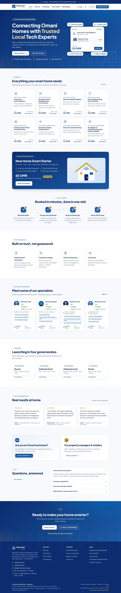
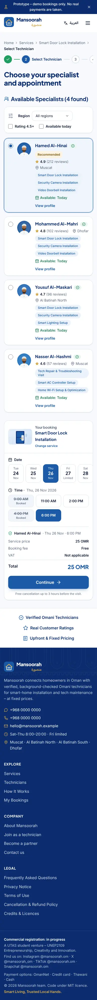
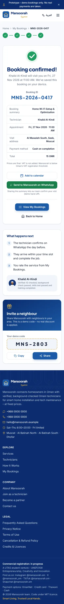

# Mansoorah · منصورة

**Connecting Omani Homes with Trusted Local Tech Experts** — *Smart Living, Trusted Local Hands.*

Mansoorah is a smart digital directory and service platform that connects homeowners and residents in Oman with **verified, background-checked Omani technicians** for smart-home installation (smart locks, cameras, video doorbells, lighting, hubs) and tech maintenance (Wi-Fi, smart AC controllers, indoor gadgets) — at **one fixed OMR price per service**, with no app needed.

🔗 **Live site:** https://saeedsami559-prog.github.io/mansoorah/
📦 **Repository:** https://github.com/saeedsami559-prog/mansoorah

> **Demo mode.** This is a student prototype for a business that is not yet registered. Bookings are demonstrations, **no real payments are taken**, technicians and reviews are fictional samples, and all data stays in your browser (localStorage). Forms only leave the device when you explicitly click “Send on WhatsApp / e-mail”.



| Booking (EN, mobile) | Booking (AR, mobile) | Confirmation |
|---|---|---|
|  |  |  |

All 144 screenshots (24 pages × 390/768/1440 px × EN/AR) are in [`docs/screenshots/`](docs/screenshots).

## Features
- **Full booking journey**: service → technician (filters, “Recommended” best match) → 14-day date picker (Friday limited) & time slots → address, Omani mobile validation, governorate → wilayat → payment method → confirmation with booking ID `MNS-YYYY-XXXX`, `.ics` calendar file and WhatsApp hand-off.
- **My Bookings**: upcoming / completed / cancelled, reschedule, cancel (3-hour free-cancellation rule), demo “mark as completed”, **rating flow** with stars, tags and feedback.
- **8 services + New Home Smart Starter package (55 OMR)**, each with a bilingual SEO landing page, what’s included/not included, preparation tips, FAQ and JSON-LD.
- **10 fictional technicians** with illustrated avatars, verification checklist, rating breakdown and sample reviews.
- **Supply & B2B**: Join as a technician (Free vs Pro 5 OMR/month, earnings explainer), Partners (retailers with a real scannable “Install with Mansoorah” QR card, landlords & property managers).
- **Trust layer**: How It Works & Trust and Safety, privacy notice aligned with Oman’s PDPL, terms, cancellation & refund policy, honest “Commercial registration: in progress”.
- **Bilingual EN / AR** with full RTL, persisted language choice (first visit follows the browser), Western digits for prices, natural customer-facing Arabic.
- **Light & dark themes**, demo banner, demo auth (no passwords stored), referral “Invite a neighbour” card, PWA (installable, offline shell), `track()` measurement hook (console only).

## Accounts & admin
Real accounts, bookings saved per account (log in from any device) and an admin dashboard at `/admin` run on **Supabase** (free plan).
Setup takes ~5 minutes: see [docs/SUPABASE_SETUP.md](docs/SUPABASE_SETUP.md). Until it is connected the site runs in demo mode.
The admin is whoever signs up with the team e-mail; the password is chosen at sign-up and is never in the code.

## Tech stack
Vite 5 · React 18 · TypeScript (strict) · React Router 6 · Tailwind CSS v4 (CSS-variable design tokens) · lucide-react · framer-motion (success animation only) · react-hook-form + zod · @fontsource (self-hosted Plus Jakarta Sans, Inter, IBM Plex Sans Arabic) · vite-plugin-pwa · Vitest · Playwright · ESLint + Prettier · GitHub Actions → GitHub Pages.

## Run locally
```bash
npm ci
npm run dev          # http://localhost:5173/mansoorah/
npm run typecheck && npm run lint && npm test
npm run build && npm run preview   # http://localhost:4173/mansoorah/
npm run e2e          # Playwright end-to-end tests (needs a build)
node scripts/screenshots.mjs        # visual QA screenshots → docs/screenshots
./scripts/lighthouse.sh             # mobile Lighthouse on 4 key pages
```

## Quality gates (latest run)
| Gate | Result |
|---|---|
| Typecheck, ESLint, Prettier | 0 errors |
| Unit tests (Vitest) | 35 passed – price formatting, booking total (no VAT), Omani phone validation, slot availability, i18n key parity, catalogue prices |
| E2E (Playwright, 390 px) | 7 demo-mode tests + 2 live-mode tests (accounts, login-gated booking, re-login keeps bookings, admin dashboard, rating, contact requests) passed – full booking → success → My Bookings → Rate in **EN and AR**, keyboard-only booking, login & signup validation, language toggle, full link crawl (no broken links, no page errors, consistent prices) |
| Lighthouse mobile | Home 90/100/100/100 · Services 92/100/100/100 · Service details 92/100/100/100 · Booking 91/100/100/100 (Perf/A11y/BP/SEO) |
| First-load JS | ≈ 112 KB gzip (budget 250 KB) |

## Project structure
```
src/
  components/  layout/ ui/ booking/ service/ technician/
  pages/       one file per route (auth/ for login, signup, forgot password)
  data/        services, technicians, regions, faqs, reviews, team, legal
  i18n/        en.json, ar.json, typed t() provider
  lib/         format, pricing, phone, slots, bookings, ics, whatsapp, auth, storage, track
  config/      site.ts (contact values, DEMO_MODE, rules)
  styles/      design tokens + components (Tailwind v4)
scripts/       route generation, post-build (per-route HTML, sitemap, robots), OG image, icons, QA tools
e2e/           Playwright tests
docs/          PLAN, AUDIT, ROADMAP, compliance checklist, screenshots, Lighthouse reports
```
Deep links work on GitHub Pages because the post-build step writes a real `index.html` for every static route (with its own title/description); dynamic URLs (booking IDs) use a `404.html` redirect fallback.

## Team (UTAS · UNEP2109 – Entrepreneurship, Creativity and Innovation)
| Name | Role |
|---|---|
| Said Sami Said Albalushi | Team Leader – Project Manager & Technical Lead |
| Omar Waleed Omar Albalushi | Operations & Quality Coordinator |
| Younis Hamood Alrusheidi | Marketing Lead |
| Musab Fadhil Alwardi | Finance Lead |
| Ali Said Almasoudi | Partnerships & Technician Relations Coordinator |
| Abdulrahman Fahad Said Saaiyid Alghammari | Customer Support & Content Coordinator |

## Before launch
Remaining items before a public launch:
- [x] WhatsApp / phone `+968 9479 7747` and e-mail `saeedsami559@gmail.com` (set in `src/config/site.ts`)
- [ ] `SOCIAL` handles – confirm/reserve, then set `SOCIAL_LINKS_LIVE = true`
- [ ] Real technician data (with consent) to replace the fictional profiles; real reviews only from completed bookings
- [ ] Final logo approval (current mark: `public/brand/mark.svg`)
- [ ] Arabic spelling of team names, especially “سعيّد الغماري”
- [ ] Late-cancellation fee amount in `/cancellation-refund`
- [ ] Everything in the [compliance checklist](docs/compliance/README.md): CR, e-commerce licence, Maroof, PDPL, Riyada card, Omanisation, VAT monitoring, licensed payment gateways, technician agreements
- [ ] v2 backend: see [docs/ROADMAP.md](docs/ROADMAP.md)

## Licence
Code: MIT (see `LICENSE`). Fonts: SIL OFL 1.1. Icons: ISC. All illustrations are original SVG artwork released with the code. See `/credits`.

---

## بالعربية
**منصورة** منصة رقمية تربط أصحاب المنازل في سلطنة عُمان بفنيين عُمانيين موثَّقين ومفحوصي السجل لتركيب أجهزة المنزل الذكي (الأقفال الذكية، الكاميرات، أجراس الفيديو، الإضاءة، وحدات التحكم) والصيانة التقنية (الواي فاي، تحكم المكيّفات، الأجهزة المنزلية) — بسعر ثابت واحد لكل خدمة بالريال العُماني، ودون الحاجة إلى تطبيق.

- **الموقع:** https://saeedsami559-prog.github.io/mansoorah/
- **نسخة تجريبية:** الحجوزات للعرض فقط ولا يتم أخذ أي مبالغ، والفنيون والتقييمات أمثلة افتراضية، وتبقى البيانات على جهازك.
- الموقع ثنائي اللغة بالكامل مع دعم الاتجاه من اليمين إلى اليسار، ويمكن التبديل بين العربية والإنجليزية من أعلى الصفحة.
- مشروع طلابي من جامعة التقنية والعلوم التطبيقية ضمن مقرر UNEP2109 – ريادة الأعمال والإبداع والابتكار.
